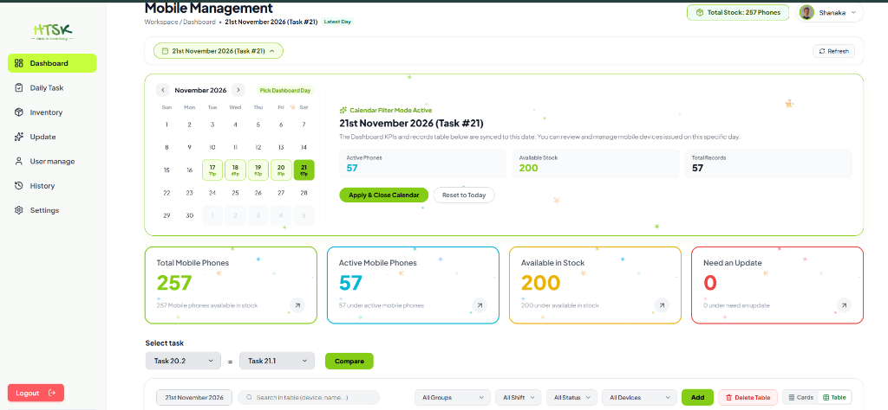
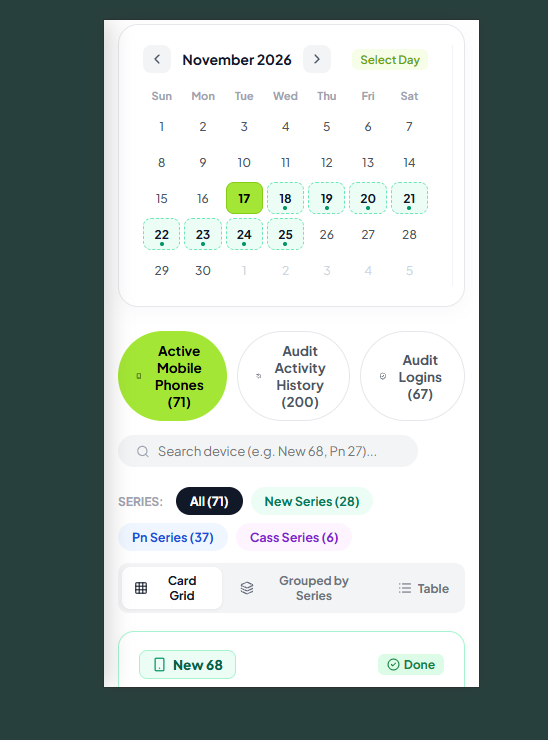
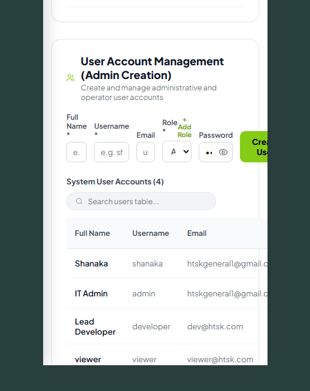
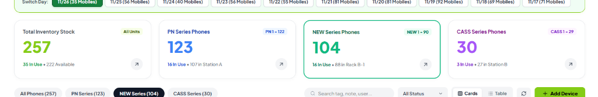
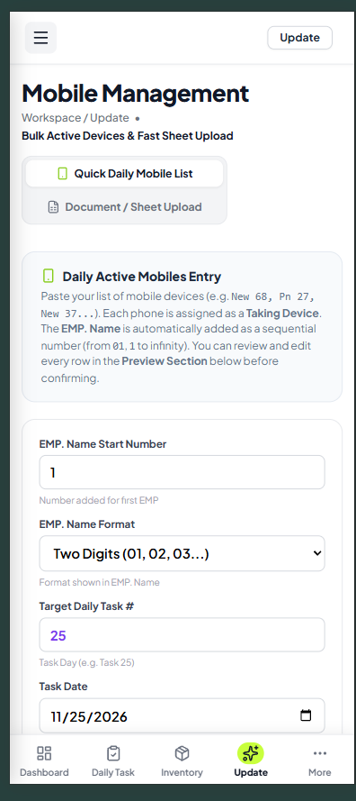

<p align="center">
  
</p>

<h1 align="center">HTSK Mobile Management System</h1>

<p align="center">
  
  
  
  
  
</p>

<p align="center">
  A production-grade, enterprise <strong>Company Mobile Device Inventory, Shift Handover & Daily Task Management Platform</strong> built for high-throughput daily device operations, real-time custody tracking, multi-round shift accountability, and native mobile responsiveness.
</p>

---

## 📸 Interface & System Screenshots

### 1. Desktop Dashboard & Fleet KPI Command Center
The main operational command center providing real-time fleet counters across **257 mobile devices**, interactive calendar filter mode, intra-day cross-task comparisons, and live device assignments.

<p align="center">
  
</p>

---

### 2. 📱 Native Responsive Mobile Experience
Native-like mobile interface engineered for mobile phone viewports, featuring fluid card grids, touch-friendly series filter pills, and a fixed 5-tab bottom navigation bar.

<p align="center">
  
  
</p>

---

### 3. Fleet Inventory & Stock Management (257 Hardware Units)
Complete inventory stock tracking across all 257 pre-cataloged hardware units with real-time custodian tracking, dynamic series range calculation, and instant day switcher navigation.

<p align="center">
  
</p>

---

### 4. Shift Handover & Multi-Round Daily Task Tracking
Dense, high-throughput daily auditing table tracking employee names, shifts, issued timestamps, return times, device details, verified signatures, and automated **Attention Required** alerts for dropped/missing devices.

<p align="center">
  
</p>

---

### 5. Fast Bulk Update & Document Ingestion Workspace
Optimized 2-column mobile and desktop workspace supporting instant list pasting with auto employee numbering, multi-format file uploads (`.xlsx`, `.docx`, `.pdf`, images), and automated OCR parsing.

<p align="center">
  
</p>

---

## 📱 Responsive Mobile UI & App-Like Experience

The platform has been re-architected with a mobile-first responsive foundation:
- **Viewport-Adaptive Design:** Seamless layout transformation across Mobile ($\le 768\text{px}$), Tablet ($768\text{px}-1024\text{px}$), and Desktop ($>1024\text{px}$).
- **Fixed 5-Tab Mobile Bottom Navigation Bar:** Direct access to `Dashboard`, `Daily Task`, `Inventory`, `Update`, and `More` bottom sheet.
- **Interactive Slide-Up "More" Sheet:** One-touch access to *User manage*, *History*, *Settings*, and *Logout*.
- **Context-Aware Floating Action Button (FAB `+`):** Context-sensitive quick-action button on mobile screens:
  - *Dashboard:* Opens direct device issuance.
  - *Daily Task:* Opens `+ Add Next Task (Round Check)`.
  - *Inventory:* Opens `+ Add Device to Inventory`.
- **Card Grid vs. Table View Toggle:** Mobile users can toggle between a dense data table and touch-friendly visual cards with large tap targets.
- **Responsive User Account Management:** Touch-friendly mobile user cards with integrated role badges, animation toggle switches, and secure password management.

---

## 🚀 Release History & Changelog

### 🟢 `v 1.0.1 - alpha 2` (Current Release — November 2026)
This release delivers full mobile responsiveness, fleet inventory expansion, 2FA security, multi-key resolution, and workflow improvements:

1. **Fleet Inventory Expansion (257 Mobile Phones):**
   - Expanded total master hardware catalog to **257 phones**:
     - **PN Series (123 Units):** `PN 1` to `PN 123` (Charging Station A)
     - **NEW Series (104 Units):** `NEW 1` to `NEW 104` (Storage Rack B-1)
     - **CASS Series (30 Units):** `CASS 1` to `CASS 30` (Charging Station B)
   - Dynamic series range badges update automatically upon adding new units.

2. **2-Factor Authentication (2FA) for Admin:**
   - Dedicated 2FA security layer for Admin account (`htskgeneral1@gmail.com` / `Password@123`).
   - 2FA verification code input with cryptographic session token validation.

3. **Official Brand Identity & Emblems:**
   - Official **HTSK Mobile Inventory** branding integrated into desktop headers and mobile drawers.
   - High-definition custom green hexagon favicon emblem (`favicon.png`) and web manifest icons.

4. **Streamlined Daily Task Initialization (First Task / Round 1):**
   - Direct bulk-entry support for initial tasks (Round 1) via list pasting, removing the requirement to enter devices one-by-one.

5. **Multi-Key Alias Resolution for Dropped Devices:**
   - Added `expandResolutionAliases` and `getDeviceResolution` to support all single-digit, leading-zero, and formatted tag variants (`Pn 02`, `Pn 2`, `New 07`, `New 7`, `Cass 01`, `Cass 1`).
   - Fixed the **✓ Mark All Returned** button to resolve 100% of unverified devices instantly.

6. **Production Database Protection:**
   - Separated code-only deployment packages (`monsterasp_deploy_code_only.zip`) from database storage, preventing accidental overwrites during server deployments.

---

### ⚪ `v 1.0.0 - alpha 1` (Initial Release — November 2026)
- **3NF Relational Architecture:** SQLite database engine (`mobile_management.sqlite`) tracking pre-cataloged hardware units.
- **Dashboard & KPIs:** 4 real-time stat cards, date-specific task filtering, and ambient card particle effects.
- **Daily Task & Intra-Day Tracking:** Multiple intra-day device checks (`Task X.1`, `Task X.2`) with attention banners for dropped or missing devices.
- **Smart File Ingestion:** Automated OCR and spreadsheet ingestion supporting `.xlsx`, `.csv`, `.docx`, `.pdf`, and `.png`.
- **RBAC & Capability Matrix:** Admin capability matrix permitting granular permission toggling for 5 system roles.

---

## 📑 Table of Contents
- [📸 Interface & System Screenshots](#-interface--system-screenshots)
- [📱 Responsive Mobile UI](#-responsive-mobile-ui--app-like-experience)
- [Release History & Changelog](#-release-history--changelog)
- [Key Features](#-key-features)
- [System Architecture & Modules](#-system-architecture--modules)
- [Operational Logic & Workflows](#-operational-logic--workflows)
- [Security, Roles & Permissions](#-security-roles--permissions)
- [Technology Stack](#-technology-stack)
- [Getting Started](#-getting-started)
- [Git Repositories](#-git-repositories)

---

## 🌟 Key Features

### 1. Dashboard & Real-Time KPIs
- **4 Interactive KPI Summary Cards:**
  - **Total Mobile Phones (257):** Full fleet catalog overview across all series.
  - **Active Mobile Phones:** Devices currently checked out and in use by shift workers.
  - **Available in Stock:** Devices currently docked in charging racks and ready for deployment.
  - **Need an Update:** Devices flagged with pending handovers or unreturned status.
- **Interactive Calendar Drawer:** Filter records and metrics by specific dates with active day green indicators.
- **Intra-Day Task Comparison:** Compare any Task A with Task B to audit hardware changes across shifts.

### 2. Daily Task & Multi-Round Tracking
- **Intra-Day Round Auditing:** Track multiple device sweeps per day (e.g. `Task 26.1 : Time 8.30 A.M.`, `Task 26.5 : Time 06.25 P.M.`).
- **Attention & Drop Highlights:** Missing or dropped devices between checks trigger red alert banners for supervisor inspection.
- **1-Click Bulk Resolutions:** **✓ Mark All Returned** button quickly resolves all dropped devices back to office stock.

### 3. Comprehensive Inventory Management
- **257 Pre-Cataloged Devices:**
  - **PN Series (123 Units):** `PN 1` to `PN 123`
  - **NEW Series (104 Units):** `NEW 1` to `NEW 104`
  - **CASS Series (30 Units):** `CASS 1` to `CASS 30`
- **Live Custodian Syncing:** Real-time linkage showing which employee currently holds each device.
- **Card & Table Views:** Switch between visual device cards and dense tabular data with search and status filtering.

### 4. Smart Ingestion & Fast Data Update
- **Flexible File Support:** Ingest device lists from Excel (`.xlsx`, `.xls`), CSV, Word (`.docx`), PDF, and Images (`.png`, `.jpg`).
- **Quick Daily Active List Entry:** Fast-entry textarea for pasting daily device numbers with auto-numbered employee assignment and live preview.

### 5. Authentication & Sensitive Data Security
- **Mandatory Login & 2FA:** Real-time credential and 2FA validation against the SQLite `system_users` database.
- **Audit Logging of All Login Events:** Successful and rejected login attempts are recorded into `audit_logins` with IP address and timestamp.
- **Anti-Brute Force Protection:** Automatic temporary security lockout after 5 consecutive failed attempts.
- **Dedicated View-Only Role (`Viewer`):** Read-only visibility without mutation rights.
- **Role-Based Access Control (RBAC):** Granular capability toggling across 5 system roles.

---

## 🏛 System Architecture & Modules

```
htsk-mobile-mgmt/
├── client/                     # React 18 + Vite Frontend Application
│   ├── src/
│   │   ├── components/
│   │   │   ├── Dashboard.jsx           # Main KPI & Calendar view
│   │   │   ├── DailyTaskSection.jsx    # Multi-round task management & bulk resolve
│   │   │   ├── InventorySection.jsx    # 257 phone catalog & custody
│   │   │   ├── UpdateSection.jsx       # Document & list ingestion
│   │   │   ├── UserManageSection.jsx   # Users, roles, permissions & mobile cards
│   │   │   ├── HistorySection.jsx      # Audit logs & login history
│   │   │   ├── SettingsSection.jsx     # Shift timings & group setups
│   │   │   ├── Sidebar.jsx             # Responsive navigation & mobile drawer
│   │   │   ├── AdminLogin.jsx          # Secure admin access & 2FA verification
│   │   │   └── SnowEffect.jsx          # Ambient card particle effects
│   │   ├── App.jsx                     # Master state & route coordinator
│   │   └── index.css                   # Unified system design & tokens
├── server/                     # Node.js + Express Backend
│   ├── database.js             # SQLite 3NF database engine & multi-key resolver
│   ├── index.js                # REST API endpoints & file ingestion
│   └── mobile_management.sqlite # Persistent SQLite database
├── docs/                       # Project documentation & screenshots
│   └── images/                 # Interface screenshots & branding assets
└── package.json                # Project dependencies & scripts
```

---

## ⚡ Operational Logic & Workflows

1. **Shift Handover / Issue Time (`Issued At`):** The timestamp when an employee is issued a mobile unit for their shift.
2. **Device Return (`Return Time`):** Recorded when the device is handed back to the charging station.
3. **Multi-Key Device Normalization:** Normalizes tags across different formats (`PN 02`, `Pn 2`, `New 07`, `Cass 12`) to ensure uniform inventory tracking.
4. **Sign Status:**
   - **Done (Green):** Employee signed or verified return.
   - **Pending (Amber):** Currently active or awaiting verification.
   - **Missing (Red):** Unaccounted during intra-day round check.

---

## 🚀 Getting Started

### Prerequisites
- Node.js (v18 or higher)
- npm (v9 or higher)

### Installation & Setup

1. **Clone the repository:**
   ```bash
   git clone https://github.com/xyruslabs/htsk-mobile-mgmt.git
   cd htsk-mobile-mgmt
   ```

2. **Install dependencies:**
   ```bash
   # Install root and backend dependencies
   npm install

   # Install frontend dependencies
   cd client && npm install && cd ..
   ```

3. **Start the development servers:**
   ```bash
   # Start backend API (Port 5100)
   npm start

   # In a separate terminal, start frontend (Port 5173)
   cd client && npm run dev
   ```

4. **Build for Production:**
   ```bash
   npm run build
   ```
   *Static assets will be compiled into `client/dist/` and served directly by the Express server on `http://localhost:5100`.*

---

## 🔗 Git Repositories

This project is configured with dual-push remote synchronization:
- **Primary Organization:** [https://github.com/xyruslabs/htsk-mobile-mgmt.git](https://github.com/xyruslabs/htsk-mobile-mgmt.git)
- **Personal Repository:** [https://github.com/d-navanith/htsk_mobile_management.git](https://github.com/d-navanith/htsk_mobile_management.git)
