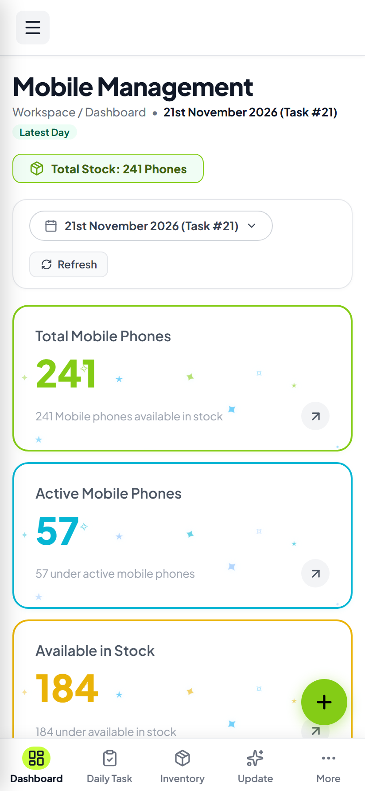
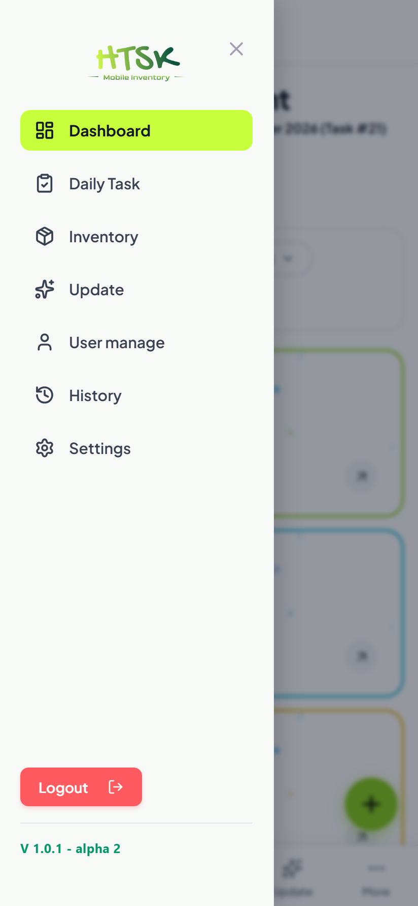
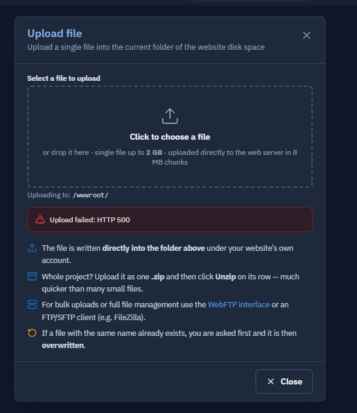

<p align="center">
  
</p>

<h1 align="center">HTSK Mobile Management System</h1>

<p align="center">
  
  
  
  
</p>

<p align="center">
  A production-grade, enterprise <strong>Company Mobile Device Inventory, Shift Handover & Daily Task Management Platform</strong> built for high-throughput daily device operations, real-time custody tracking, multi-round shift accountability, and native mobile responsiveness.
</p>

---

## 📸 Interface & System Screenshots

### 1. Desktop Dashboard & Fleet KPI Hub
The main operational command center providing real-time fleet counters across 241 mobile devices, intra-day cross-task comparison, and live device assignments.

<p align="center">
  
</p>

---

### 2. Mobile App Experience & Responsive Navigation
Native-like mobile interface featuring a fixed 5-tab bottom navigation bar, context-aware floating action buttons (FAB `+`), and collapsible workspace drawers.

<p align="center">
  
  
</p>

---

### 3. Shift Handover & Multi-Round Task Tracking
Dense, high-throughput daily auditing table tracking taking devices, return times, custodian handovers, verified employee signatures, and multi-round sweeps.

<p align="center">
  
</p>

---

### 4. Fleet Inventory & Stock Management
Complete catalog of 241 pre-cataloged hardware units (PN, NEW, CASS series) with real-time custodian tracking, status tags, and quick-add controls.

<p align="center">
  
</p>

---

### 5. Fast Bulk Update & Document Ingestion Workspace
Optimized 2-column mobile and desktop workspace supporting instant list pasting with auto EMP numbering, file uploads (.xlsx, .docx, .pdf, images), and automated OCR parsing.

<p align="center">
  
</p>

---

## 🚀 Release History & Changelog

### 🟢 `v 1.0.1 - alpha 2` (Current Release — November 2026)
This release delivers a comprehensive **Mobile App-Like Experience & Responsiveness Overhaul**, visual branding updates, bug fixes, and streamlined workflows across all modules:

1. **Brand Identity & Header Redesign:**
   - Integrated the official **HTSK Mobile Inventory** logo into the sidebar drawer with responsive scaling and centered positioning.
   - Removed cluttered button pills from the top mobile header, leaving a clean native-app bar featuring the menu hamburger button `[ ☰ ]` and user profile avatar.

2. **Mobile App Navigation System:**
   - Added a fixed 5-tab **Mobile Bottom Navigation Bar** (`Dashboard`, `Daily Task`, `Inventory`, `Update`, `More`) with native iOS/Android haptic styling.
   - Built an interactive slide-up **More** bottom sheet providing 1-tap access to *User manage*, *History*, *Settings*, and *Logout*.

3. **Page-Unique Floating Action Buttons (FAB `+`):**
   - Resolved the `Uncaught ReferenceError: rounds is not defined` crash in Daily Task.
   - Implemented context-aware, unique actions for the floating `(+)` button:
     - **Dashboard:** Direct *Add Device to Active Table* dialog.
     - **Daily Task:** Direct *+ Add Next Task (Round Check)* modal with auto-formatted check time.
     - **Inventory:** Direct *+ Add Device to Inventory* modal with phone type selector.

4. **Dashboard Calendar Responsiveness:**
   - Fixed the 2-column drawer overflow bug where task summary cards clipped off-screen on mobile.
   - Automatically collapses into a 100% full-width calendar grid on mobile with KPI stat cards stacked cleanly below.

5. **Update Workspace Overhaul:**
   - Replaced bulky stacked buttons with a sleek, horizontal **Segmented Mode Switcher** (`Quick Mobile List` | `Document Upload`).
   - Redesigned the configuration form from 8 tall stacked rows into a compact **2-Column Form Grid** (`Target Task #`, `Date`, `Shift`, `Time`, `EMP Start #`, `Format`, `Group`, `Action`).
   - Compacted intra-day task status indicator to minimize vertical scrolling.

6. **User Account Management Mobile Cards:**
   - Replaced the wide, cut-off desktop table with dedicated **Mobile User Cards** on mobile viewports ($\le 768\text{px}$).
   - Includes bold name headers, username handles, role pills, active/inactive badges, inline animation permission switches, and touch-friendly delete buttons.
   - Fixed the user creation form to use a spacious 2-column / 1-column layout so inputs never squeeze into single-line cut-offs.

7. **History Section Tab Chips & Collapsible Calendar:**
   - Fixed the bug where tab buttons wrapped into deformed giant circles on mobile viewports.
   - Implemented sleek, non-wrapping horizontal tab chips (`Active Phones`, `Activity History`, `Audit Logins`) with smooth horizontal scrolling.
   - Collapsed the large 350px calendar drawer by default on mobile so users immediately view active devices upon loading.

8. **Security & Access Control:**
   - Updated primary administrator credentials and enforced strict view-only capability enforcement for `Viewer` roles.
   - Anti-brute force lockout after 5 failed attempts with audit login logging.

---

### ⚪ `v 1.0.0 - alpha 1` (Initial Release — November 2026)
- **3NF Relational Architecture:** SQLite database engine (`mobile_management.sqlite`) tracking 241 pre-cataloged devices (`NEW`, `PN`, `CASS`).
- **Dashboard & KPIs:** 4 real-time stat cards, date-specific task filtering, and ambient card particle effects (Snow, Rain, Sparkle).
- **Daily Task & Intra-Day Tracking:** Multiple intra-day device checks (`Task X.1`, `Task X.2`) with attention banners for dropped or missing devices.
- **Smart File Ingestion:** Automated OCR and spreadsheet ingestion supporting `.xlsx`, `.csv`, `.docx`, `.pdf`, and `.png`.
- **RBAC & Capability Matrix:** Admin capability matrix permitting granular permission toggling for 5 system roles.

---

## 📑 Table of Contents
- [📸 Interface & System Screenshots](#-interface--system-screenshots)
- [Release History & Changelog](#-release-history--changelog)
- [Key Features](#-key-features)
- [System Architecture & Modules](#-system-architecture--modules)
- [Operational Logic & Workflows](#-operational-logic--workflows)
- [Security, Roles & Permissions](#-security-roles--permissions)
- [Technology Stack](#-technology-stack)
- [Getting Started](#-getting-started)
- [Git Repositories](#-git-repositories)

---

## 🌟 Key Features

### 1. Dashboard & Real-Time KPIs
- **4 Interactive KPI Summary Cards:**
  - **Total Mobile Phones (241):** Full fleet catalog overview across all series.
  - **Active Mobile Phones:** Devices currently checked out and in use by shift workers.
  - **Available in Stock:** Devices currently docked in charging racks and ready for deployment.
  - **Need an Update:** Devices flagged with pending handovers or unreturned status.
- **Interactive Calendar Drawer:** Filter records and metrics by specific dates (e.g., Nov 17, 18, 19, 20) with active day indicators.
- **Ambient Visual Effects:** Configurable card animation engine (Snow, Rain, Sparkle) with admin toggle and per-user permission control.

### 2. Daily Task & Multi-Round Tracking
- **Intra-Day Round Auditing:** Track multiple device sweeps per day (e.g. `Task 19.1 : Time 8.30 A.M.`, `Task 19.2 : Time 02.00 P.M.`).
- **Separate Scroll Containers:** Each round has an independent scrollable table container for streamlined review without endless page scrolling.
- **Attention & Drop Highlights:** Missing or dropped devices between rounds are highlighted in red for immediate supervisor inspection.
- **1-Click Resolutions:** Quickly mark unverified devices as **Returned in Office** or **Missing**, automatically synchronizing historical records and previous rounds.
- **Accurate Return Accounting:** Accurately accounts for repeated device return events (e.g., PN 34 returned across multiple shifts/employees on the same day).

### 3. Comprehensive Inventory Management
- **257 Pre-Cataloged Devices:**
  - **PN Series (123 Units):** `PN 1` to `PN 123` (Charging Station A)
  - **NEW Series (104 Units):** `NEW 1` to `NEW 104` (Rack B-1)
  - **CASS Series (30 Units):** `CASS 1` to `CASS 30` (Station B)
- **Dynamic Series Range Calculation:** Range badges automatically update whenever new hardware units are added to inventory.
- **Live Custodian Syncing:** Real-time linkage showing which employee currently holds each device.
- **Card & Table Views:** Switch between visual device cards and dense tabular data with search and status filtering.

### 4. Smart Ingestion & Data Update
- **Flexible File Support:** Ingest device lists from Excel (`.xlsx`, `.xls`), CSV, Word (`.docx`), PDF, and Images (`.png`, `.jpg`).
- **Automated Signature & OCR Recognition:** Automatically interprets marked/signed rows as `Done` and unsigned rows as `Pending`.
- **Quick Daily Active List Entry:** Fast-entry textarea for pasting daily device numbers with auto-numbered employee assignment and live preview.

### 5. Authentication & Sensitive Data Security
- **Mandatory First-Load Login:** In order to safeguard sensitive operational records and employee contact data, the application strictly requires authentication on first load before rendering any workspace data or making API calls.
- **Server-Side Authentication API (`/api/login`, `/api/auth/verify`):** Real-time credential validation against the SQLite `system_users` database, cryptographically random session tokens, and instant invalidation on account deactivation.
- **Audit Logging of All Login Events:** Successful and rejected login attempts are recorded into `audit_logins` with IP address and timestamp.
- **Anti-Brute Force Protection:** Automatic temporary security lockout after 5 consecutive failed attempts.
- **Protected Administrator Accounts:** Core administrative accounts (e.g., `Shanaka`, `Admin`) cannot be set to Inactive or deleted.
- **Dedicated View-Only Role (`Viewer`):**
  - Read-only visibility into current devices, stock catalog, KPI statistics, daily rounds, and activity history.
  - Restricted from mutating data: all add, edit, delete, custody handover, quick notes, and device resolution controls are automatically hidden from the UI and strictly protected with `403 Forbidden` response guards on the backend.
  - The `User manage` workspace navigation and administrative profile shortcuts are hidden from viewer accounts.
- **Admin Permission Management & Capability Matrix Grid (Shanaka Control):**
  - Shanaka (Admin) can view and toggle permissions for all roles directly in the interactive **Role Capability Matrix** grid table.
  - Multi-column table layout: `Capability Description` column alongside role columns (`Admin`, `Viewer`, `Developer`, `Supervisor`, `Staff`).
  - **Explicit View-Only Capabilities:**
    - `view_devices`: `View Mobile Devices (Only View)`
    - `view_daily_tasks`: `View Daily Tasks (Only View)`
    - `view_inventory`: `View Inventory Stock (Only View)`
  - **Granular Operational Capabilities:**
    - `manage_devices`: `Add & Edit Mobile Devices`
    - `manage_groups_shifts`: `Add & Edit Shifts`
    - `handover_devices`: `Perform Shift Handover`
    - `return_devices`: `Accept Inventory Returns`
    - `manage_users`: `Create & Manage User Accounts`
    - `view_audit_logs`: `View System Audit Logs`
    - `delete_records`: `Delete Records`
  - Real-time instant toggling with sleek lime-green toggle switches and immediate persistence to the SQLite database via `PUT /api/permissions/toggle`.
- **Dynamic Role Creation:** Admins can create custom roles (e.g., *Manager*, *Auditor*, *Technician*) directly from the user creation dropdown with auto-generated permission templates.
- **Role Filtering:** Filter user listings and permission matrix by specific roles.
- **Per-User Animation Visibility:** Granular toggle controlling which users see ambient animations on their dashboard.

### 6. Admin Profile Management & Interactive Dropdown Menu
- **Interactive Profile Capsule & Dropdown:** Clicking the top-right user profile pill in any workspace view opens a themed dropdown menu showcasing the user's avatar, full name, username handle, and active role badge.
- **Profile Customization (`ProfileModal.jsx`):**
  - **Avatar & Photo:** Live preview with one-click selection from curated presets, custom image file upload (`/api/profile/avatar`), or custom image URL input.
  - **Full Name, Username & Email:** Editable with real-time uniqueness validation against existing system accounts.
  - **Password & Security:** Self-service password change with existing password verification for protection of sensitive data.
- **Instant Synchronization:** Updates apply immediately to header avatars, local storage, session state, and SQLite database.

### 7. Audit Trail & History
- Complete chronological history log recording all device additions, edits, returns, shift handovers, and administrative logins.

---

## 🏛 System Architecture & Modules

```
htsk-mobile-mgmt/
├── client/                     # React 18 + Vite Frontend Application
│   ├── src/
│   │   ├── components/
│   │   │   ├── Dashboard.jsx           # Main KPI & Calendar view
│   │   │   ├── DailyTaskSection.jsx    # Multi-round task management
│   │   │   ├── InventorySection.jsx    # 241 phone catalog & custody
│   │   │   ├── UpdateSection.jsx       # Document & list ingestion
│   │   │   ├── UserManageSection.jsx   # Users, roles, permissions & animations
│   │   │   ├── HistorySection.jsx      # Audit logs & login history
│   │   │   ├── SettingsSection.jsx     # Shift timings & group setups
│   │   │   ├── Sidebar.jsx             # Fixed responsive navigation
│   │   │   ├── AdminLogin.jsx          # Secure admin access
│   │   │   └── SnowEffect.jsx          # Ambient card particle effects
│   │   ├── App.jsx                     # Master state & route coordinator
│   │   └── index.css                   # Unified system design & tokens
├── server/                     # Node.js + Express Backend
│   ├── database.js             # SQLite 3NF database engine & business logic
│   ├── index.js                # REST API endpoints & file ingestion
│   └── mobile_management.sqlite # Persistent SQLite database
└── package.json                # Project dependencies & scripts
```

---

## ⚡ Operational Logic & Workflows

1. **Shift Handover / Issue Time (`Issued At`):**
   - The timestamp when an employee is issued a mobile unit for their shift (e.g., `7.30 A.M.`).
2. **Device Return (`Return Time`):**
   - Recorded when the device is handed back to the charging station (e.g., `5.51 P.M.`).
3. **Device Tagging:**
   - Normalizes tags across different formats (`PN 34`, `Pn34`, `New 25`, `Cass 12`) to ensure uniform inventory tracking.
4. **Sign Status:**
   - **Done (Green):** Employee signed or verified return.
   - **Pending (Amber):** Currently active or awaiting verification.
   - **Missing (Red):** Unaccounted during intra-day round check.

---

## 🔒 Security, Roles & Permissions

- **Default Roles:** `Admin`, `Supervisor`, `Staff`, `Developer`.
- **Dynamic Roles:** Admins can define custom roles with instant permission template seeding.
- **Admin Safeguard:** Root admin accounts cannot be deactivated via the UI or API.
- **Role-Based Access Control (RBAC):** Real-time permission evaluation for device management, user administration, and audit logs.

---

## 🚀 Getting Started

### Prerequisites
- Node.js (v18 or higher)
- npm (v9 or higher)

### Installation & Setup

1. **Clone the repository:**
   ```bash
   git clone https://github.com/xyruslabs/htsk-mobile-mgmt.git
   cd htsk-mobile-mgmt
   ```

2. **Install dependencies:**
   ```bash
   # Install root and backend dependencies
   npm install

   # Install frontend dependencies
   cd client && npm install && cd ..
   ```

3. **Start the development servers:**
   ```bash
   # Start backend API (Port 5100)
   npm start

   # In a separate terminal, start frontend (Port 5173)
   cd client && npm run dev
   ```

4. **Build for Production:**
   ```bash
   npm run build
   ```
   *Static assets will be compiled into `client/dist/` and served directly by the Express server on `http://localhost:5100`.*

---

## 🔗 Git Repositories

This project is configured with dual-push remote synchronization:
- **Primary Organization:** [https://github.com/xyruslabs/htsk-mobile-mgmt.git](https://github.com/xyruslabs/htsk-mobile-mgmt.git)
- **Personal Repository:** [https://github.com/d-navanith/htsk_mobile_management.git](https://github.com/d-navanith/htsk_mobile_management.git)
